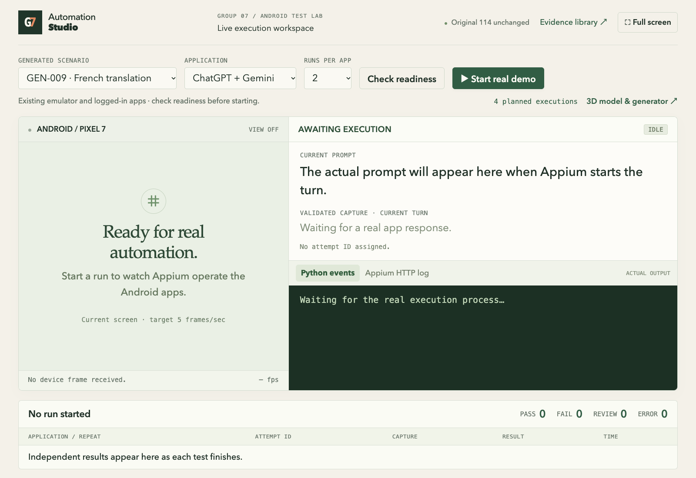

# Group 7 — Android Test Automation

Deliverable #3: reproducible testing of the **ChatGPT and Gemini Android apps** using Python, Appium and UiAutomator2, with a live presentation workbench and traceable execution evidence.



The workbench continuously displays the current emulator screen beside actual execution logs, prompts, validated responses and per-attempt results. Its default demonstration runs generated case **GEN-009 twice on each app**, producing four independent Android test attempts. The screen mirror targets approximately 5fps; observed capture-to-browser delay in the final acceptance averaged **0.30 seconds**.

## Recorded results and scope

| Evidence scope | Attempts | PASS | FAIL | REVIEW | ERROR |
|---|---:|---:|---:|---:|---:|
| Original formal study: 19 cases × 2 apps × 3 rounds | 114 | 37 | 0 | 58 | 19 |
| Independent historical 3D model extension | 16 | 12 | 0 | 1 | 3 |
| Independent live-workbench demonstration runs | 12 | 12 | 0 | 0 | 0 |

The original formal results are preserved, including all REVIEW and ERROR rows. Their coverage distinguishes **111 primary submitted cases and 3 linked coverage retests**. The 58 formal human review decisions remain unsigned. The live-workbench records comprise two four-attempt acceptance runs and one additional four-attempt demonstration run; they are not merged into the original study or used to replace errors.

The 3D generator produces **16 Input × Context × Output coordinates**, with **four executable selected scenarios**. Recorded model coverage is partial. The repository also retains 19 original functional scenarios and generation/augmentation tooling. Local framework tests and synthetic replay fixtures are separate from actual Android application results.

## Run the live workbench

Use the existing configured Android SDK, logged-in apps, Appium server and Python environment. The recorded environment was Apple M2 Max, Pixel 7 Android 15 / API 35, Appium 4.0.0 and UiAutomator2 9.2.1. Exact observed versions accompany individual runs.

```bash
git clone https://github.com/Lushangtu123/group7-android-test-automation.git
cd group7-android-test-automation
GROUP7_PYTHON=/actual/path/to/existing/venv/bin/python bash "Start Live Demo.command"
```

Open **http://127.0.0.1:8770**, check readiness, then click **Start real demo**. The launcher does not install software or create accounts. Opening the page does not start Android tests automatically. For a separate Python environment, the mobile dependencies are listed in `engine/requirements-optional-appium.txt`; the observed installed versions are in `engine/requirements-mac-installed.txt`.

If the existing Appium server is stopped, run `bash "Start Appium.command"` in another Terminal. Use `ANDROID_HOME` / `ANDROID_SDK_ROOT` and `GROUP7_APPIUM_LOG` for your existing SDK and server log. The inspected configuration in `engine/data/android_appium_config.local.json` contains sanitized paths and selectors, not credentials. Real app versions or interfaces can require re-inspection; do not guess replacement selectors.

The live view hides navigation and unverified/account pages. A stale view is labelled explicitly. Stopping preserves partial evidence, and refreshing reconnects an active task without creating another worker. Exported results retain raw/derivative hash mappings. See the [full operating guide](docs/LOCAL_DEMO_GUIDE.md) and [Chinese presentation guide](DEMO_GUIDE_ZH.md).

## Inspect the evidence

- [Three formal rounds](evidence/formal/runs): attempts.csv, summary.json, complete captured responses, turn checkpoints, execution logs and environment records.
- [Original 114-case statistics](evidence/formal/statistics/full114_statistics.json) and [repeat stability](evidence/formal/statistics/repeated_case_stability.csv).
- [Formal source/batch map](evidence/formal/BATCH_SOURCE_VERSION_MAP.csv) and [copied-file archive mapping](evidence/SOURCE_ARCHIVE_MAPPING.json).
- [Unsigned 58-row human review worksheet](reference/documents/HUMAN_REVIEW_WORKSHEET.csv) and [3D traceability](reference/documents/3D_MODEL_TRACEABILITY.csv).
- [Independent live-demo ledger](evidence/LIVE_DEMO_LEDGER.csv) and [per-run evidence](evidence/live_demo_runs).
- [Updated English execution report](reference/documents/REPORT_EN_UPDATED.md), [cost records](evidence/formal/statistics/execution_costs.json), and [complexity statistics](reference/complexity.json).
- [Live-workbench acceptance report](verification/DELIVERY_REPORT.json) and [visual revision checks](verification/VISUAL_QA.json).

The code and light visual skin are current. Earlier execution snapshots retain the source and screenshots actually used for those runs, including the earlier dark skin. The later visual revision changed only the header and CSS and did not execute additional Android tests. A subsequent frontend usability revision changed the browser HTML, CSS and JavaScript only; it was checked with one separate two-attempt demo run that is not part of the published evidence. See [visual provenance](VISUAL_REFINEMENT.md).

## Download the submission packages and Demo

The current portable presentation project, with the revised workbench, is in the [latest Release](https://github.com/Lushangtu123/group7-android-test-automation/releases/latest) (v1.4.1 at the time of writing). It differs from v1.0.0 only in the browser files, visual notes and presenter guides listed in its `PACKAGE_SOURCE_MAPPING.json`.

Use the [v1.0.0 Release](https://github.com/Lushangtu123/group7-android-test-automation/releases/tag/v1.0.0) for the original portable presentation project, Core Evidence, Representative Evidence, Optimization Evidence, the additional live-run export, the preserved legacy console, and the existing optimized MP4. Large ZIPs and videos are release assets rather than Git history. The video is the existing reviewed recording; this upload does not create a new movie.

The complete original raw archive stays in the local project. Public assets are existing sanitized derivatives with source mappings and checksums. Browser profiles, account credentials, installed environments and raw runtime directories are excluded. The repository's evidence library contains curated visuals; the companion release packages provide broader execution evidence. The video can be played directly after downloading its release asset; the local `/video` link additionally requires the original companion-directory layout.

Verify a checkout with `shasum -a 256 -c MANIFEST.sha256`. Release assets have their own `SHA256SUMS.txt`; checksum files inside the original distributions describe those distributions' bytes.

## Reproduce the checks

Use the existing Appium Python environment for the Python commands:

```bash
python3 -m unittest discover -s tests -v
node --test tests/view_logic.test.mjs
PYTHONPATH=engine python3 -m unittest discover -s engine/tests
```

Recorded local validation: **45 console tests, 9 JavaScript checks and 197 engine tests**. These are local checks, not Android test attempts. GitHub Actions runs the same checks and the checksum manifest on every pull request (`.github/workflows/tests.yml`). Node is needed only for the JavaScript checks, not for serving the workbench.

To start a new independent execution of the original 19-case catalog, use a fresh output directory:

```bash
PYTHONPATH=engine python3 -m group7_auto.cli run \
  --mode appium --app both --repeats 3 \
  --config engine/data/android_appium_config.local.json \
  --output runtime/formal_reproduction_NEW_RUN
```

That command plans 114 new application attempts. It does not authenticate or overwrite the published historical study. The CLI's replay mode is explicitly synthetic and must not be reported as live app execution.
